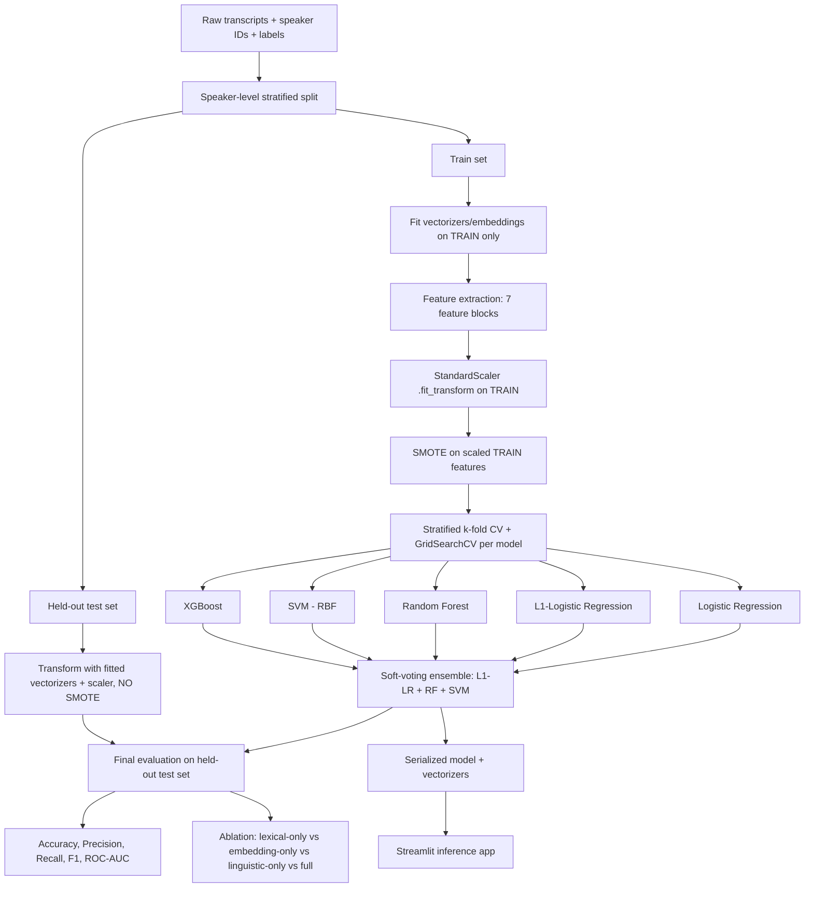

# System Architecture — Text-Based Dementia Classification

## 1. Pipeline overview

## 2. Feature blocks (7, each computed once — no duplicates)

| Block | Method | Dim |
|---|---|---|
| Lexical (TF-IDF) | `TfidfVectorizer`, fit on train | configurable, e.g. 300 |
| Lexical (Count) | `CountVectorizer`, fit on train | configurable, e.g. 300 |
| Word2Vec | Locally trained `gensim` model, mean-pooled | 100–300 |
| GloVe | `glove-wiki-gigaword-300`, mean-pooled | 300 |
| Sentence embedding | spaCy `en_core_web_md` doc vector | 300 |
| Hesitation count | Rule-based lexicon count | 1 |
| Handcrafted linguistic | token count, sentence count, avg token length, noun count, verb count | 5 |

## 3. Data-leakage safeguards (the parts most reviewers check)

1. **Split by speaker ID, not by transcript**, before anything else touches the data.
2. **All vectorizers/embeddings fit only on the training partition**; test data is only ever `.transform()`-ed.
3. **SMOTE runs only inside the training fold**, via an `imblearn.pipeline.Pipeline`, so it is refit per CV fold rather than once globally.
4. **The held-out test set is never resampled, never seen during hyperparameter search.**

## 4. Files in this codebase

- `src/config.py` — paths and constants
- `src/data_preparation.py` — loads transcripts, does the speaker-level split
- `src/feature_extraction.py` — batch feature extraction for train/test sets (fixes the duplicate-Word2Vec bug)
- `src/train_pipeline.py` — imblearn Pipeline (Scaler → SMOTE → Classifier), CV + GridSearchCV, soft-voting ensemble, model serialization
- `src/evaluate.py` — full metrics + feature-block ablation study
- `src/predict_single.py` — single-transcript inference (used by the app)
- `app.py` — Streamlit demo

## 5. How to describe this in your Methods section

Use the safeguards in §3 verbatim as bullet points — reviewers specifically look for confirmation that resampling and vectorizer fitting happened only on the training partition, and that no speaker appears in both splits. Report the ablation table from `evaluate.py` to justify combining all seven feature blocks rather than asserting it.
